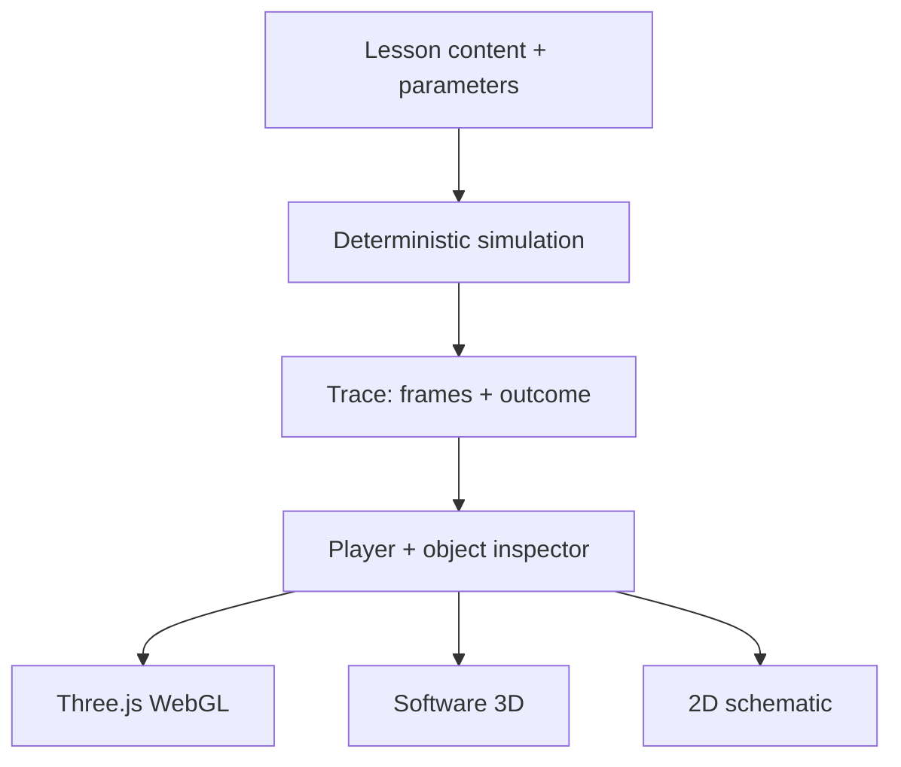

# Architecture

Block Atlas is a static, bilingual learning application with 85 lessons, eight categories, and five curated learning paths. React handles navigation and interaction; TypeScript describes the content and simulation contracts; Vite builds the application; Three.js provides the WebGL renderer.

## The central design

A lesson supplies concise teaching content and a small parameter space. A pure simulation function turns the selected parameters into a deterministic sequence of frames. The player chooses a frame, and every renderer displays that same state.

This separation makes the mechanism inspectable and keeps visual presentation from deciding algorithm outcomes. Animation and camera movement belong to the presentation layer. Camera motion, rendering speed, and playback speed must not change the computed result.

## Source layout

| Area | Responsibility |
| --- | --- |
| `src/types.ts` | Shared lesson, control, frame, node, link, metric, and simulator contracts |
| `src/content/` | Bilingual lesson metadata, explanations, sources, challenges, catalog, and paths |
| `src/simulation/` | Domain-specific deterministic simulations, shared helpers, and dispatch |
| `src/components/Scene.tsx` | WebGL scene and renderer selection |
| `src/components/SoftwareScene.tsx` | Software projection of the 3D world |
| `src/components/Projection.tsx` | Explicit flat SVG schematic |
| `src/App.tsx` | Application navigation and integration |
| `tests/` | Catalog, trace, search, and domain invariants |
| `docs/research-*.md` | Primary sources, topic-specific mechanisms, and model boundaries |

The blockchain, distributed systems, and advanced-topic modules separate subject areas without changing the shared rendering contract.

## Content contract

A lesson has a stable identifier, localized title and hook, category, difficulty, approximate duration, search tags, controls, takeaway, model boundary, challenge, sources, and related topics.

Localized teaching text uses explicit English and Turkish values. Short object labels and numeric values can use language-neutral technical notation. Supporting explanation belongs in localized descriptions or object details.

Controls are ranges, toggles, selections, or text inputs. Every control should change a visible computation, event, or outcome in at least one relevant scenario. Avoid controls that merely recolor a scene while implying a protocol change.

Each source should identify an original paper, protocol specification, standard, or maintained official technical document. A lesson's model boundary should name omitted behavior and assumptions that affect its conclusions.

## Simulation contract

A simulator accepts a lesson identifier and parameter values and returns a trace, or returns no result when that module does not own the identifier.

A trace contains:

- An ordered set of frames and a localized outcome.
- A short localized title and explanation for each frame.
- Nodes with stable identifiers, position, kind, status, and optional values or details.
- Links that reference existing nodes.
- Optional metrics, a focus target, and a teaching note.

Keep identifiers stable across frames when an object represents the same participant, block, shard, or event. This supports meaningful transitions and preserves object selection.

Small scenes are intentional. Shared coordinates use an X/Z floor approximately within `[-6, 6]` and a Y range of `[0, 4]`. Short labels and compact values reduce occlusion. Prefer a focused set of objects over a large network whose state cannot be read.

Randomized algorithms use seeded, reproducible draws in the teaching model. The same lesson and parameters must produce the same trace. This provides a useful comparison when a learner changes one variable.

## Three views of one state

| View | Mechanism | Purpose |
| --- | --- | --- |
| WebGL 3D | Three.js geometry, camera, and orbit controls | Explore spatial relationships and inspect objects |
| Software 3D | Canvas2D projects world vertices through an orthographic camera and sorts geometry by depth | Preserve the spatial model when WebGL is unavailable |
| 2D schematic | SVG places the same logical objects and connections in a flat diagram | Make topology and labels available in a deliberately flat view |

The software renderer is a geometric 3D projection. It does not simulate a GPU pipeline, and visual details can differ from the WebGL renderer. Both 3D views must retain the meaning of nodes, links, status, and metrics.

The schematic is a separate, explicitly selected presentation. It must show the same algorithm state as the other views. Fallback selection must not modify simulation parameters or lesson progress.

## Teaching flow

The interface moves from discovery to explanation to experimentation:

1. Choose a catalog topic or a six-lesson learning path.
2. Follow a short guided trace, pausing or stepping as needed.
3. Inspect a participant, block, or message to understand its local state.
4. Change the scenario controls in the sandbox and compare the result.
5. Try the challenge, inspect the sources or model boundary, and continue to a related topic.

The five paths are **Your first block**, **How nodes agree**, **When things go wrong**, **A world of connections**, and **Beyond the blockchain**.

The primary scene should answer one visible question at a time. Long explanations belong in disclosures; the scene, concise frame text, and object inspector should carry the main lesson.

## Model fidelity

A teaching simulation must preserve the causal mechanism it claims to demonstrate. Scope is explicit when a complete implementation would hide that mechanism.

Examples of boundaries documented in the advanced lessons include:

- Reed–Solomon recovery performs finite-field interpolation in a small `(6, 3)` model; corruption detection is a separate concern.
- Bloom filters compute an actual bit array and can show false positives; deletion is outside that model.
- NTP computes the four-timestamp estimate, including the effect of asymmetric delay.
- HLC applies clock-update rules; a timestamp order alone does not prove causality.
- The Bullshark lesson follows a specific published leader-support decision in a small DAG. It does not represent the complete protocol.
- The VDF lesson uses deliberately tiny arithmetic to expose repeated squaring and a verification relation. Its parameters are unsuitable for cryptographic security.

The topic notes carry the precise assumptions and primary references:

- [Blockchain research](research-blockchain.md)
- [Distributed systems research](research-distributed.md)
- [Advanced topics research](research-advanced.md)

## Navigation and local state

The application uses hash-based lesson routes so a static host can serve a single entry document. Vite's relative asset base, `./`, allows the build to live under a repository subdirectory.

Language preferences and learning progress live in browser storage. Storage access should fail gracefully when unavailable. The interface must remain usable without persisted state.

Search works over the local catalog. Normalization needs to handle both English and Turkish input, including relevant case and diacritic differences. Search normalization and route handling require regression coverage; see the [validation record](validation.md) for the current evidence status.

## Accessibility and motion

Accessibility is part of the presentation contract:

- Playback and scenario controls must remain usable by keyboard, with visible focus.
- A learner must be able to pause and step through a trace.
- Reduced-motion preferences should avoid unnecessary automatic movement.
- Labels, object details, and status text must carry information also expressed through color.
- Renderer changes must preserve the current lesson, parameters, and selected frame.
- The schematic and object inspector should provide readable alternatives when a 3D scene is difficult to interpret.

These requirements need browser verification as well as code review. Their acceptance status is tracked separately in [validation](validation.md).

## Build and delivery

`npm run build` performs the TypeScript project build and produces Vite output in `dist/`. The application requires no backend or live chain access.

The CI workflow runs dependency installation, tests, and the production build for pushes and pull requests. A separate Pages workflow runs only when manually dispatched. It repeats tests and the build, uploads `dist/`, and deploys through the repository's `github-pages` environment. Repository Pages must be configured to use GitHub Actions before that workflow can publish.

Actions are pinned to verified commit SHAs. Node.js 24 is selected for application commands. Read access is sufficient for CI; Pages deployment receives its publishing and OIDC permissions in the deployment job.

## Adding a lesson

1. Select a primary source and identify one mechanism that can be shown accurately in a small state space.
2. Add bilingual content, controls, a challenge, a model boundary, and source links.
3. Implement a pure trace with stable object identities and visible causal transitions.
4. Test domain properties, boundary cases, reproducibility, and the effect of each control.
5. Connect the lesson to the catalog and appropriate related topics.
6. Inspect the complete guided and sandbox flows in all three views and both languages.

Ask whether a newcomer can explain what changed, why it changed, and which participant knows it. Revise the scene when that answer depends on reading a long paragraph.
